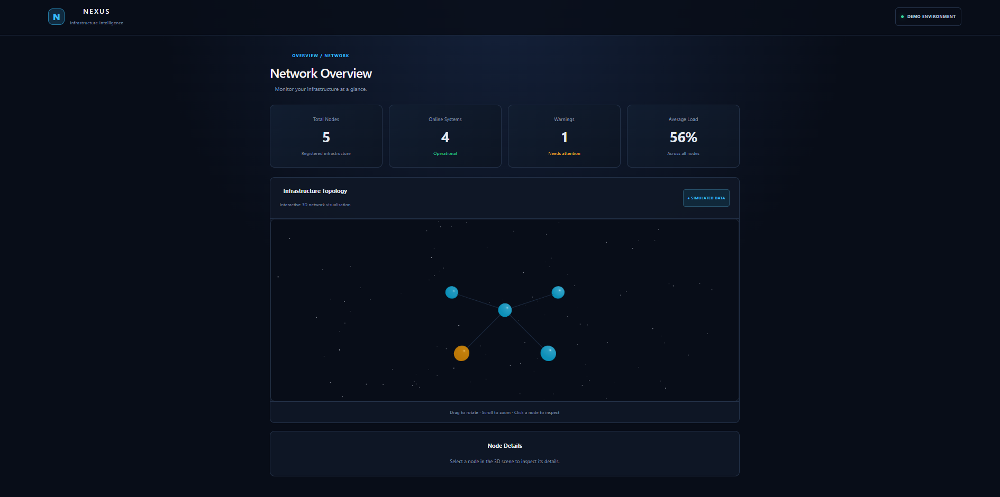
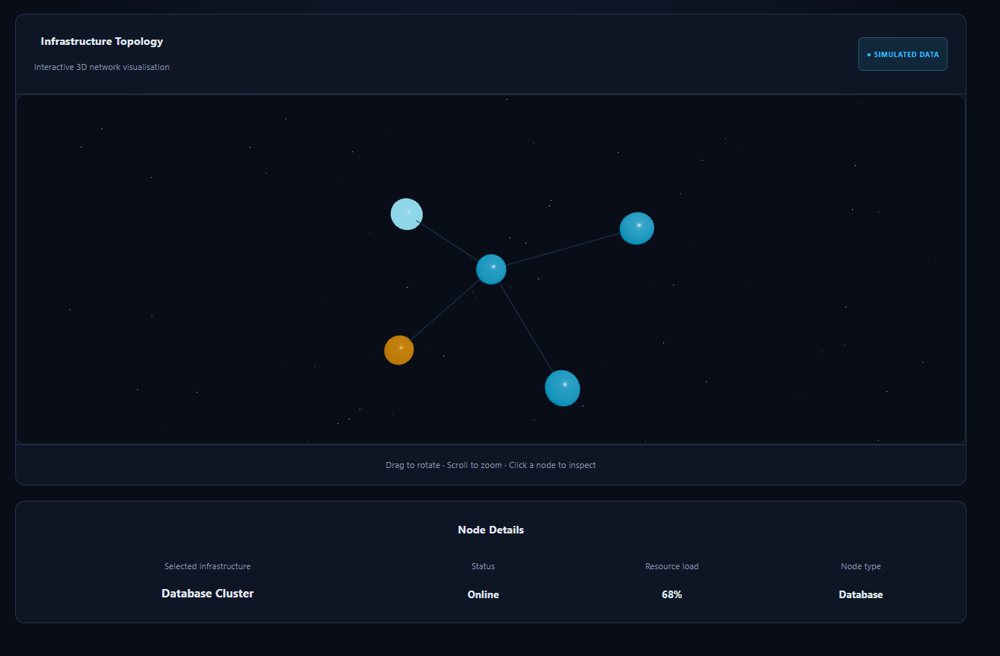
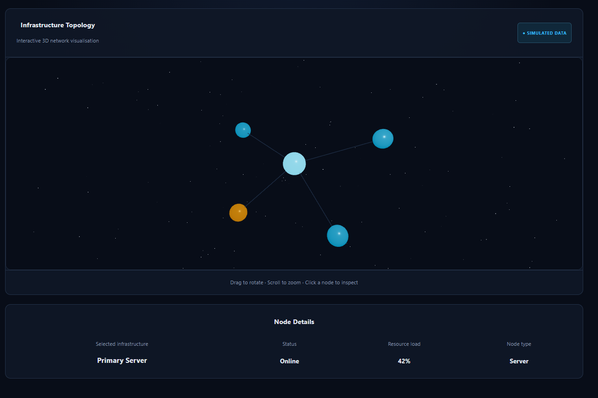
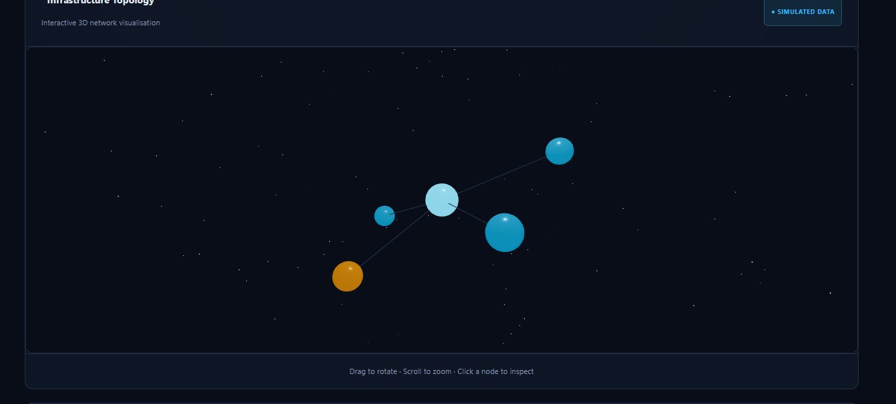

# Nexus 3D

Nexus 3D is an interactive 3D network visualisation dashboard built with React and Three.js. The project explores how 3D graphics can be integrated into web applications to represent network infrastructure, communicate system status, and create more engaging data visualisations.

The project combines my background in 3D animation with my experience in front-end and full-stack web development.

Screenshots
The Main Page
1. 

Selecting A Node
2. 

Selecting A Different Node
3. 

Moving the 3D Scene
4. 

## Features

- **Interactive 3D scene:** Displays a network of nodes representing servers, databases, gateways, and storage infrastructure.
- **Network connections:** Visual connections link individual nodes to the central server.
- **Node selection:** Select individual nodes to interact with the visualisation.
- **Status indicators:** Different colours distinguish normal and warning states.
- **Interactive camera controls:** Rotate and zoom around the scene to explore the network from different angles.
- **Animated data packets:** Visualises simulated data movement between connected nodes.
- **Data-driven rendering:** Network nodes are defined in a separate data module, keeping the network configuration separate from the scene rendering logic.

## Tech Stack

- **React** – Component-based UI development.
- **Three.js** – 3D rendering and graphics.
- **React Three Fiber** – Integrates Three.js with React.
- **React Three Drei** – Provides reusable helpers for 3D scenes, including camera controls and visual elements.
- **Vite** – Development server and build tooling.
- **Lucide React** – Icon components.

## Getting Started

### Prerequisites

- Node.js
- npm
- Git

### Installation

Clone the repository:

```bash
git clone https://github.com/JLampProf/Nexus
```

Navigate into the project directory:

```bash
cd nexus
```

Install dependencies:

```bash
npm install
```

Start the development server:

```bash
npm run dev
```

Open the local URL displayed in the terminal to view the application.

### Production Build

To create a production build, run:

```bash
npm run build
```

To preview the production build locally:

```bash
npm run preview
```

## Project Structure

```text
src/
├── components/
│   ├── NetworkNode.jsx
│   └── NetworkScene.jsx
├── data/
│   └── networkData.js
├── App.jsx
├── main.jsx
└── ...
```

- **`NetworkScene.jsx`** – Sets up the 3D scene, lighting, camera controls, network connections, and scene composition.
- **`NetworkNode.jsx`** – Defines the appearance and interaction behaviour of individual network nodes.
- **`networkData.js`** – Stores the network node data, including identifiers, types, statuses, positions, and simulated load values.
- **`App.jsx`** – Provides the application-level layout and integrates the network visualisation with the surrounding interface.

## Current Scope

Nexus 3D currently uses sample network data to demonstrate interactive 3D visualisation concepts. The displayed network and data packet movement are illustrative rather than connected to live infrastructure or real-time monitoring services.

The project is being developed incrementally, with an emphasis on understanding the underlying technologies and maintaining a clear, component-based structure.

## Future Development

Planned areas for further development include:

- Expanding the dashboard with additional system metrics and node information.
- Improving the presentation of selected-node details.
- Exploring more advanced 3D interactions and visualisation techniques.
- Investigating performance optimisation for larger and more complex scenes.
- Exploring how live data could be integrated into the visualisation.

## Background

This project brings together my interests in 3D animation and web development. With a background in 3D animation and experience building React applications, I am exploring how interactive 3D environments can be used to present technical information through the browser.

Nexus 3D is an ongoing learning and portfolio project focused on practical implementation, experimentation, and developing a deeper understanding of web-based 3D graphics.
